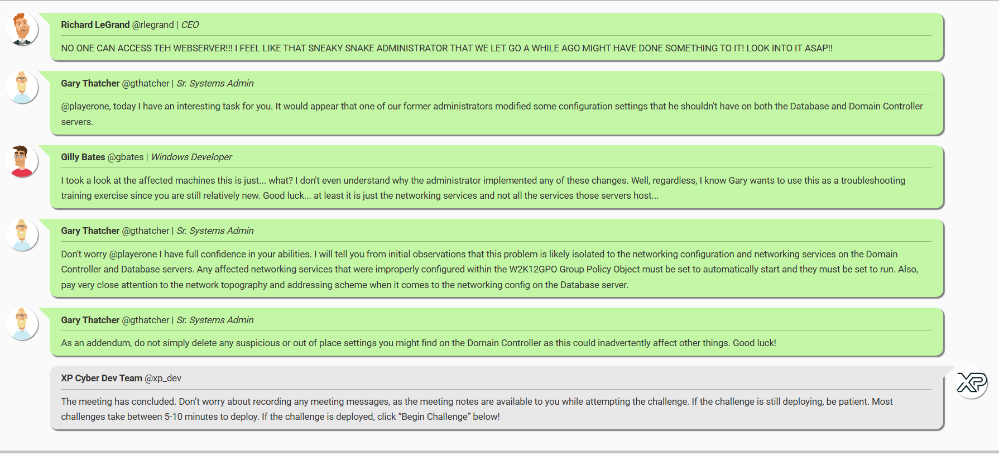
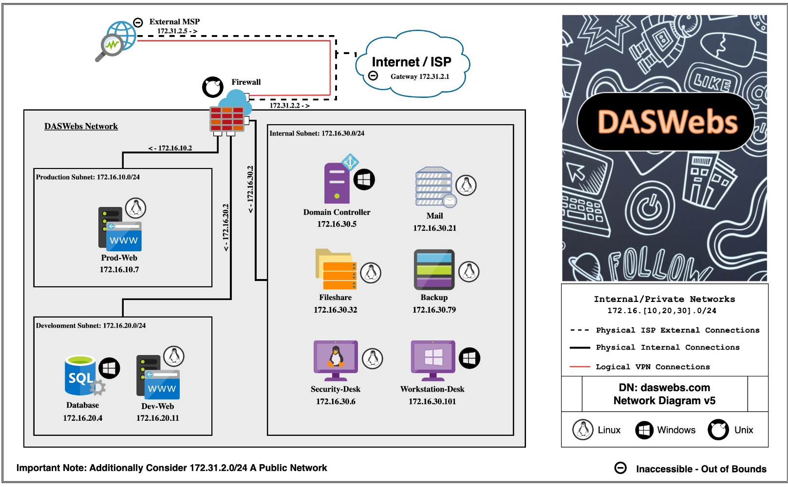
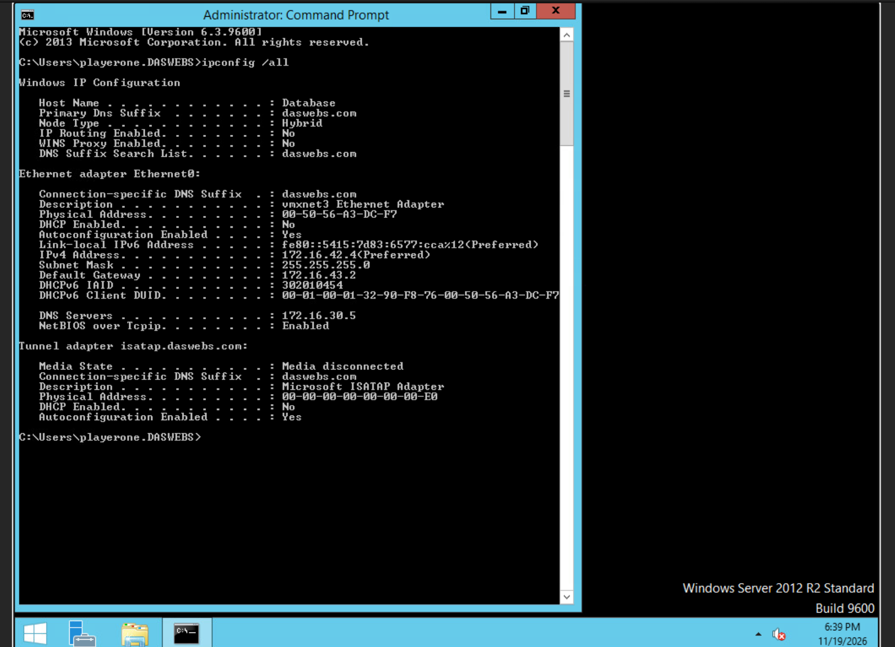
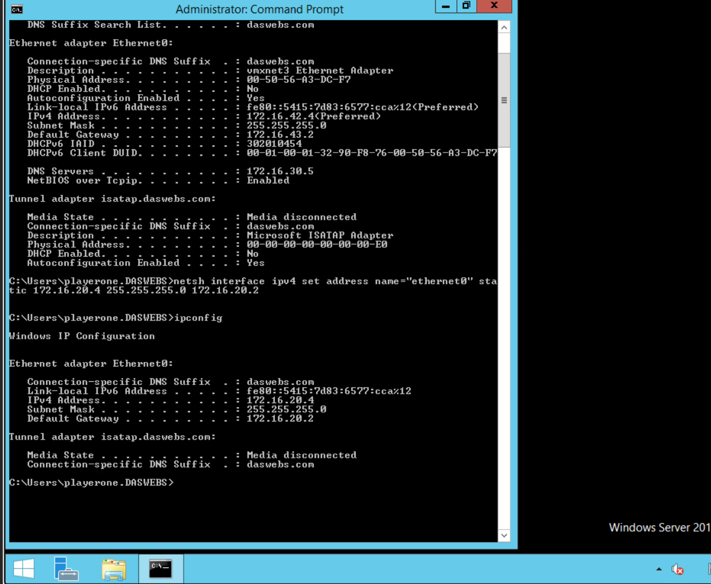
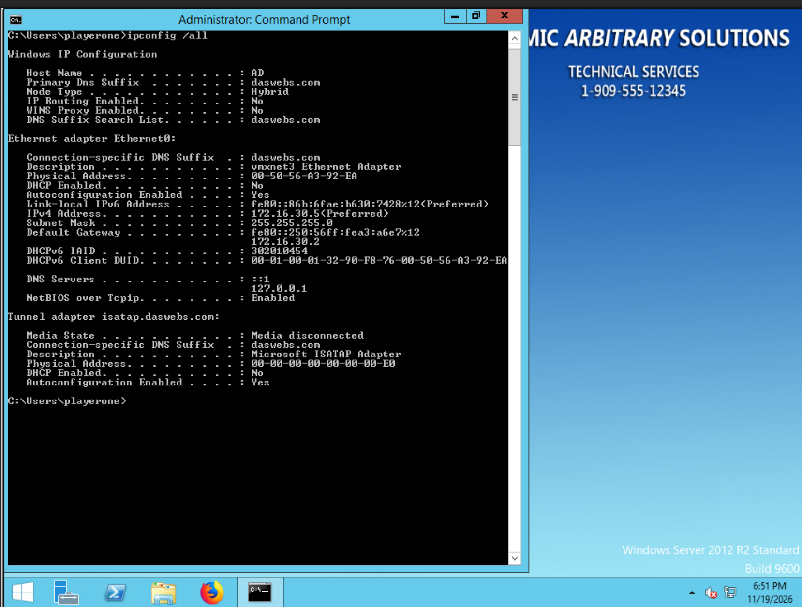
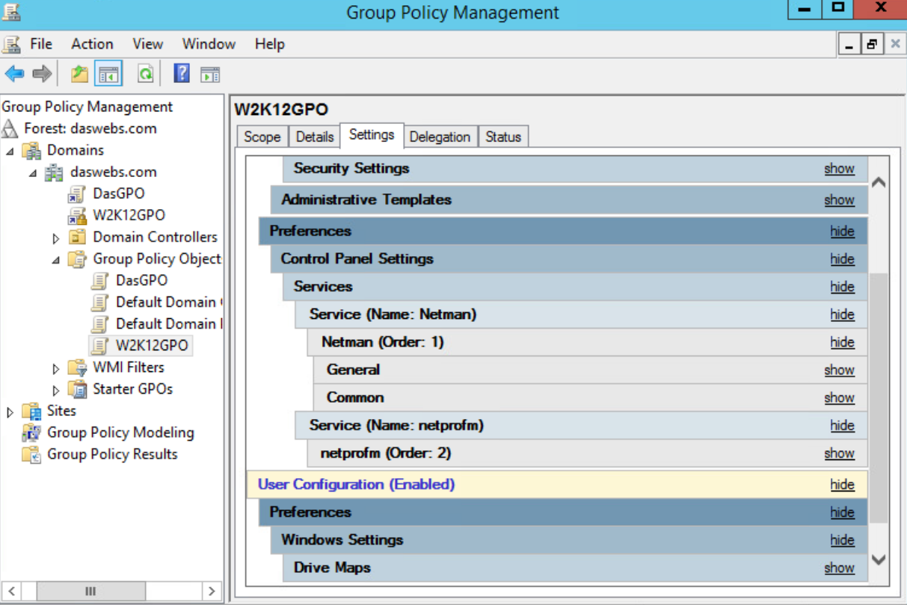
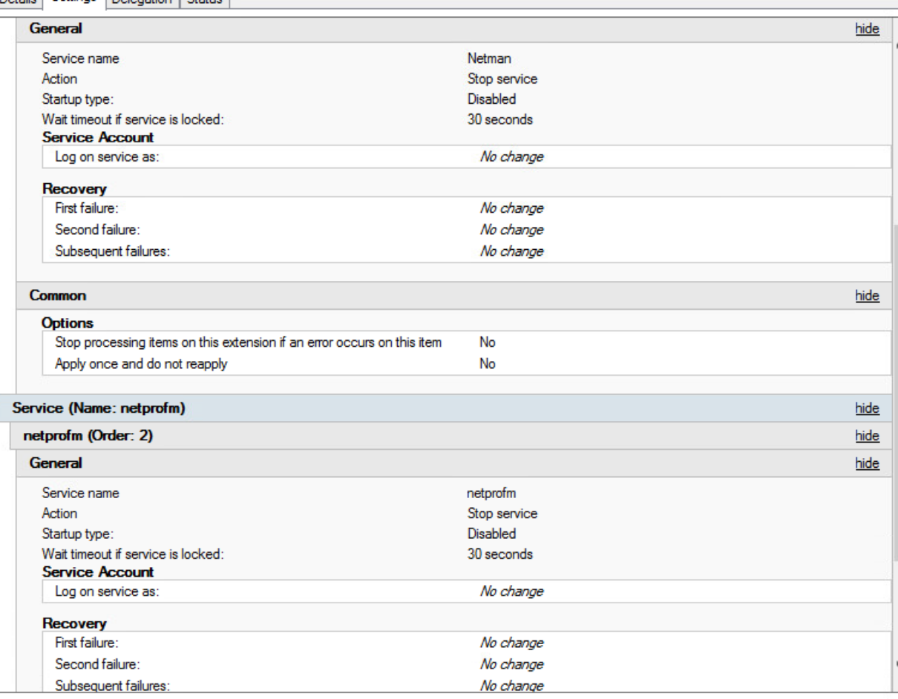
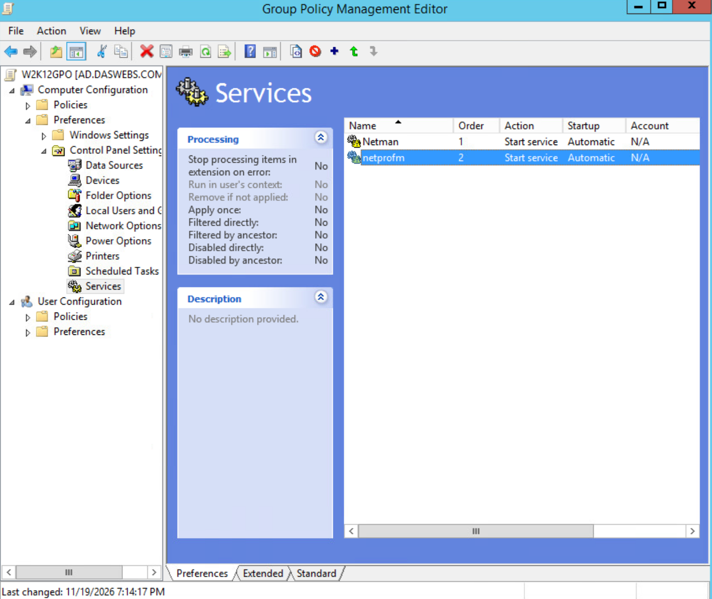
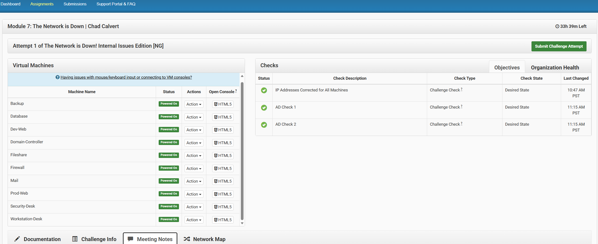

# Windows Server Network Troubleshooting Lab

## Objective

The purpose of this XP Cyber Range challenge was to investigate and resolve network configuration issues affecting the Database Server and Domain Controller within the daswebs.com environment. A former administrator had modified the Database Server's network settings and disabled networking services through Group Policy, causing disruptions to the organization's network. My goal was to identify the incorrect configurations, restore the affected services, and verify that the systems were functioning properly without changing unrelated settings.

## Tools and Utilities

- Windows Server 2012 R2
- Command Prompt
- ipconfig
- netsh
- Windows Server Manager
- Group Policy Management
- Group Policy Management Editor
- Windows Services

## Challenge Scenario

The challenge involved troubleshooting network issues caused by unauthorized configuration changes on two Windows servers. I used the network topology and existing server configurations to identify the affected settings before making changes.



## Task 1 – Investigating the Database Server

1. I started by reviewing the network topology to identify the expected IP addresses, default gateways, and subnets. The Database Server was assigned to the development subnet `172.16.20.0/24`, with an expected IP address of `172.16.20.4` and default gateway of `172.16.20.2`.
2. I accessed the Database Server and opened Command Prompt as Administrator. I ran `ipconfig /all` to inspect its network configuration and found that the IPv4 address was incorrectly set to `172.16.42.4` and the default gateway to `172.16.43.2`.
3. I compared the results with the network topology and confirmed that the subnet mask and DNS settings were correct. Only the IPv4 address and default gateway needed to be changed.





## Task 2 – Correcting the Database Server Network Configuration

1. I used the Windows `netsh` utility to correct the Database Server's static IPv4 address and default gateway without modifying the existing DNS configuration.
2. I entered the following command in Command Prompt:

```cmd
netsh interface ipv4 set address name="Ethernet0" static 172.16.20.4 255.255.255.0 172.16.20.2
```

3. After applying the changes, I ran `ipconfig` to verify the updated configuration. The results confirmed that the Database Server was using the correct IP address and default gateway according to the network topology.



## Task 3 – Investigating and Correcting Group Policy

1. I accessed the Domain Controller and ran `ipconfig /all` to verify its network configuration. The IP address `172.16.30.5` and default gateway `172.16.30.2` matched the network topology, so no changes were needed.
2. I opened Windows Server Manager, navigated to Group Policy Management, and located the `W2K12GPO` Group Policy Object. I initially checked Computer Configuration > Policies > Windows Settings > Security Settings > System Services, but the services were listed as Not Defined.
3. I continued investigating and found the affected settings under Computer Configuration > Preferences > Control Panel Settings > Services. Two services, Network Connections (`Netman`) and Network List Service (`netprofm`), were configured to stop and had their startup types set to Disabled.
4. I edited both existing service entries, changing their actions to Start service and startup types to Automatic. I kept the original entries rather than deleting them to avoid affecting other configurations.
5. After applying the changes, I reviewed the Group Policy settings again and confirmed that both services were configured to start automatically.









## Final Results

I returned to the XP Cyber Range dashboard after correcting the Database Server's network settings and restoring the networking services through Group Policy. All three validation checks displayed green checkmarks with the status Desired State, confirming that the required configurations had been restored.

- **IP Addresses Corrected for All Machines:** Passed
- **AD Check 1:** Passed
- **AD Check 2:** Passed

**Final Result: 3/3 Checks Passed**



This challenge gave me additional hands-on experience with Windows Server network troubleshooting and Group Policy administration. I used `ipconfig` and `netsh` to investigate and correct network settings, then worked through Group Policy Management to identify and repair services that had been intentionally disabled. One important part of the investigation was finding the affected services under Group Policy Preferences after initially checking System Services. It reinforced the importance of reviewing different configuration locations and verifying existing settings before making changes.

## Documentation and Verification

The following files include my troubleshooting documentation and the official XP Cyber Range submission report.

- **[Windows Server Network Troubleshooting Report (Word)](Documents/Windows_Server_Network_Troubleshooting_Report.docx)**
- **[Official XP Cyber Range Submission Report (PDF)](Documents/EdwardPenaDeDios_NCPReport170302.pdf)**

## Project Information

**Platform:** XP Cyber Range  
**Challenge:** The Network is Down! Internal Issues Edition [NG]  
**Completion Date:** November 19, 2026  
**Challenge ID:** 138  
**Submission ID:** 170302  
**Final Result:** 3/3 Checks Passed
